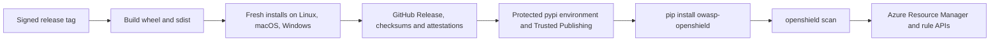

# OpenShield scanner CLI

The standalone CLI runs the Azure rule engine on your machine and prints a scan result. It does not start the hosted API, use PostgreSQL, or execute remediation scripts. The Python distribution is `owasp-openshield`; the command is `openshield`. The `openshield` project on PyPI belongs to another publisher.

## Install and authenticate

Python 3.11 or later is required. After the first signed release publishes to PyPI:

```sh
python -m venv .venv
. .venv/bin/activate                 # Windows PowerShell: .venv\Scripts\Activate.ps1
python -m pip install owasp-openshield
python -m pip check
openshield --version
```

Before PyPI publication, install a wheel downloaded from the signed GitHub Release or built from the reviewed source. Verify its SHA-256 against the release manifest before installing it. A PR build is not a PyPI release.

The CLI uses Azure's `DefaultAzureCredential` chain. For local use, `az login` is one supported option. In automation, use an appropriate workload identity or service principal. Grant the identity read access to the subscription and to the specific resource APIs needed by the rules. Some identity and DevOps rules need additional Microsoft Graph or Azure DevOps permissions; a subscription Reader role alone does not prove their coverage. The CLI first acquires an Azure Resource Manager token and checks that the subscription is readable. It does not modify Azure resources.

```sh
openshield scan --subscription-id 00000000-0000-0000-0000-000000000001
openshield scan --subscription-id 00000000-0000-0000-0000-000000000001 --format json

# Alternative to repeating the flag:
export AZURE_SUBSCRIPTION_ID=00000000-0000-0000-0000-000000000001
openshield scan
```

The UUID above is an example, not a usable subscription. `openshield --help`, `openshield scan --help`, and `openshield --version` work without Azure credentials.

## Output and exit status

Readable output shows the scan ID, subscription, status, finding count, each finding's severity, rule ID and resource ID, and failed rule IDs. `--format json` prints the existing scan result object, including `findings`, `evaluations`, `failed_rule_ids`, and `severity_contract_version`. On startup or configuration failure, JSON mode returns a small error object with `status`, `subscription_id`, `failed_rule_ids`, and `error`.

The following is **synthetic offline output** to explain the format. It is not evidence of an Azure scan:

```text
OpenShield scan offline-example
Subscription: 00000000-0000-0000-0000-000000000001
Status: completed
Findings: 1
  [HIGH] AZ-TEST-001: example-resource
Failed rules: none
```

A [terminal recording of an installed local wheel](assets/cli-installed-wheel.cast) captures `pip check`, `openshield --version`, `openshield scan --help`, and invalid-configuration JSON with exit code 2. Play it with `asciinema play docs/assets/cli-installed-wheel.cast` if asciinema is installed. The recorded development version came from the PR checkout; the recording does not show a live Azure scan or an install from PyPI.

| Exit | Meaning |
| --- | --- |
| 0 | The engine completed its run. Findings may be present. |
| 2 | Configuration or authentication failed, the subscription could not be read, a rule could not load or finish, or the scan failed. |

`status: incomplete` and `failed_rule_ids` identify a known rule failure. A rule may produce findings and still be incomplete. A missing packaged rule is reported by comparing the installed modules with `scanner/rules/manifest.txt`.

## Troubleshooting

- `authentication_failed`: renew the credential used by `DefaultAzureCredential`. For an Azure CLI login, run `az login`, then verify ARM token acquisition with `az account get-access-token --resource https://management.azure.com/ --subscription <id> --query expiresOn -o tsv`. This displays only the expiry. Never paste the token into an issue or PR.
- `subscription_unavailable`: verify the subscription ID, selected tenant, and read access with `az account show --subscription <id>`. Subscription Reader access alone may not cover Graph or Azure DevOps rules.
- `incomplete`: inspect `failed_rule_ids` in the result. If a packaged rule is missing or fails to import, reinstall a verified wheel. If a rule cannot query an Azure API, check the identity's service-specific permissions. Do not interpret the remaining findings as complete coverage.
- Package not found on PyPI: the first signed release has not published yet, or publishing was skipped by the protected setup gate. Use a verified GitHub Release wheel when one exists. Installing the unrelated `openshield` distribution will not provide this CLI.

**Coverage limit:** Most legacy rules have not yet migrated to per-resource `evaluate()` results. Their `UNKNOWN` evaluation placeholders mean that a zero-finding completed scan is not proof that every resource was inspected or compliant. See the [evaluation contract](../scanner/evaluation.py) and [rule migration epic](https://github.com/OWASP/openshield/issues/380). Some Azure SDK helpers handle service failures internally; the CLI's subscription preflight cannot prove that every downstream API call succeeded. Review `evaluations` and rule logs before making assurance claims.

## Safety and data handling

- The scanner reads Azure state. Packaged playbooks are reference files; the CLI never runs them.
- JSON and readable findings can contain Azure resource IDs, names, and configuration evidence. Store outputs as sensitive operational data and redact them before posting in an issue or PR.
- Error output avoids echoing raw Azure exception bodies, credentials, and tokens. The CLI does not persist scans locally or send findings to OpenShield's hosted API.
- Use a dedicated least-privilege identity for automated scans. Do not put client secrets in command arguments or checked-in files.
- An install from a local wheel proves that artifact can be installed. It does not prove that the package exists on PyPI or that a real subscription scan succeeded.

## Package and release blueprint



The package contains `openshield`, the standalone `scanner` modules and all `scanner.rules` modules, `contracts/severity.v1.json`, and referenced `playbooks/cli` scripts. It excludes the API, worker entry points, database, frontend, website, tests, and deployment files. `scanner/engine.py` imports scanner metrics from `openshield.metrics`; `api.observability` re-exports the same collectors for the hosted services.

The release job verifies that the signed tag points to `main`, builds and installs both Python artifacts, and adds their hashes and provenance attestations to the existing GitHub Release. A separate job with only `id-token: write` uses PyPI Trusted Publishing from the protected `pypi` environment. A repository administrator must create that environment with required reviewers, and the PyPI owner must register `OWASP/openshield`, `release.yml`, and `pypi` before the first release. The repository variable `PYPI_TRUSTED_PUBLISHING_READY=true` is set only after both controls are verified; without it, the PyPI job is skipped. Recheck name availability immediately before tagging. Pending publisher registration does not reserve a name.

Release evidence must be reported separately: local tests, clean artifact installs, three-platform CI, human review, signed tag, GitHub Release assets, PyPI publication, and an installation from the public PyPI index. None implies the next gate occurred.
